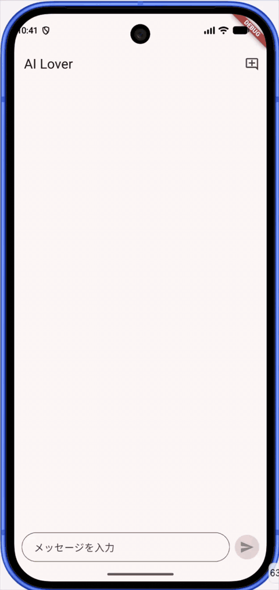
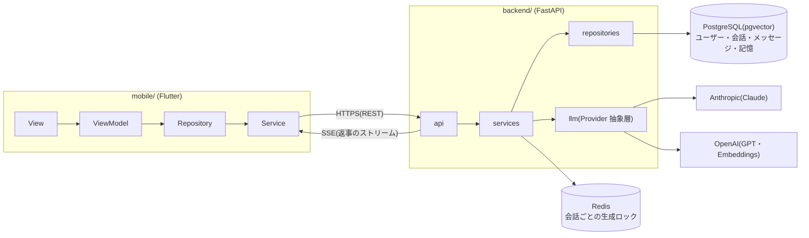
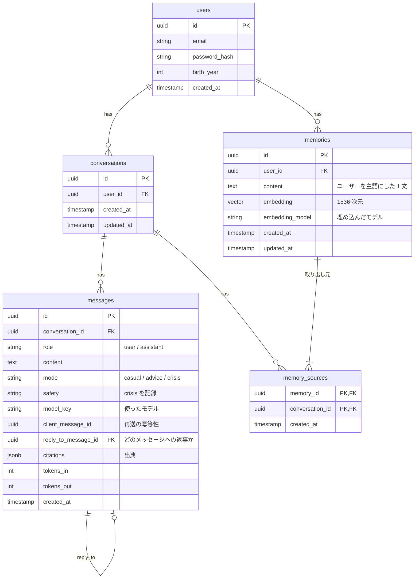
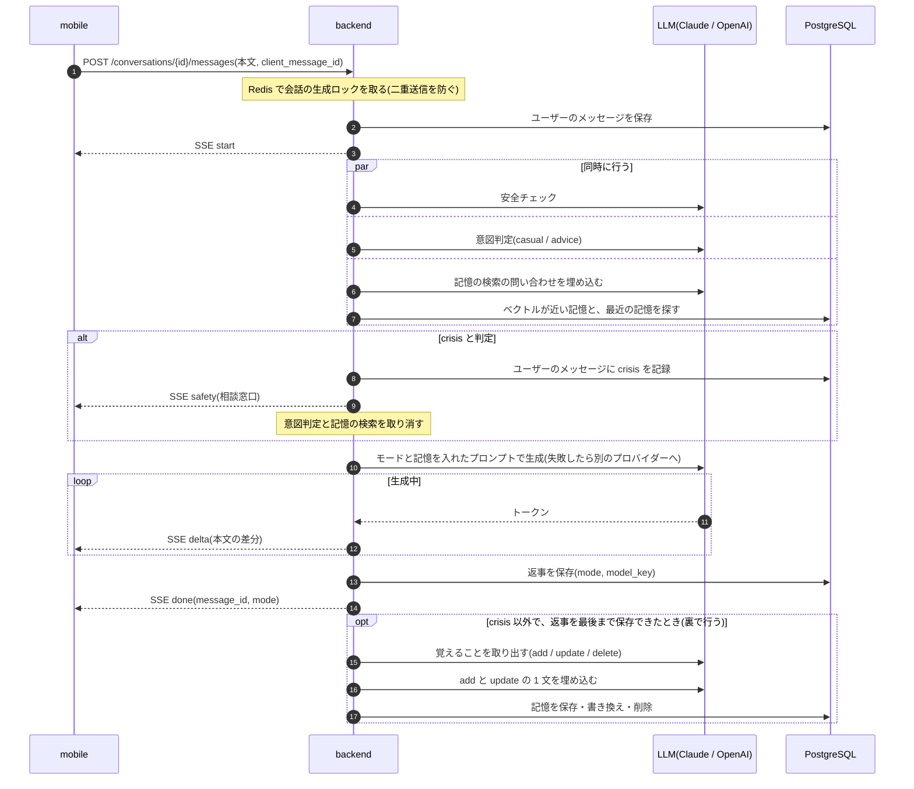
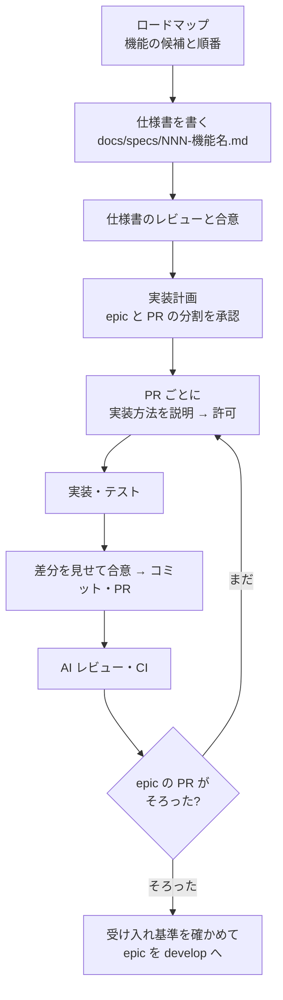

# ai_lover

AI彼氏チャットアプリ。普段は甘く寄り添い、相談されたときは根拠に基づいてアドバイスする。

## デモ

雑談(「おはよう」)には短く甘く返し、相談(「友達と喧嘩した」)には気持ちを受け止めたうえで具体的に提案する。返事は SSE で少しずつ流れて届く。

## 目的

恋人のように話を聞いてくれる相手がほしい人に、安心して話せる場所をつくる。

- **普段は甘く寄り添う**: 雑談では共感を中心に、短く返す
- **相談には根拠で答える**: 悩みを相談されたら、共感 → 整理 → 根拠つきの提案の順で答える。迎合せず、必要なら優しく反対意見も言う
- **安全を最優先する**: 自傷・希死念慮などの命に関わる話を検知したら、甘い返事をやめて相談窓口を案内する
- **依存を助長しない**: 深夜の長時間の利用で休憩をすすめるなど、アプリに縛りつけない

## 機能

| 機能 | 内容 |
|---|---|
| チャットと SSE での返事 | 送信すると、返事が少しずつ流れて届く。停止・再送・二重送信の防止、モデルの自動フォールバック |
| 意図判定と応答モード | メッセージごとに軽量モデルで雑談(`casual`)か相談(`advice`)かを判定し、口調・長さ・モデルを切り替える |
| 安全チェック | 命に関わる話を検知すると `crisis` モードにし、受け止める返事の後に相談窓口(電話・SNS 相談)のカードを出す。開き直しても同じ位置に出る |
| 長期記憶 | 会話から覚えておくことを取り出し、新しい会話でも関係のある記憶を使って返事をする。覚えていることは「覚えていること」の画面で見て消せる。会話で「それは忘れて」と言えば直せる |

## 全体構成

| 層 | 技術 |
|---|---|
| mobile | Flutter, Riverpod, dio, go_router, freezed |
| backend | Python 3.12+, uv, FastAPI, Pydantic v2, SQLAlchemy 2 (async), Alembic |
| LLM | `anthropic` / `openai` SDK を `app/llm` の抽象層でラップ。記憶の埋め込みは `text-embedding-3-large` |
| DB | PostgreSQL(pgvector)、Redis |

### この構成にした理由

| 決めたこと | 理由 |
|---|---|
| 返事は **SSE** で流す | 返事はサーバーから一方向に流すだけなので、WebSocket ほどの双方向性は要らない。HTTP のままなので、認証・ロードバランサー・再接続の扱いが簡単 |
| **LLM の抽象層**(`LLMProvider`)を挟み、モデルはサーバーが選ぶ | 1 社の障害で止まらないよう、最初の文字を送る前に失敗したら別のプロバイダーへ自動で切り替える。用途(雑談・相談・判定)ごとにモデルとコストを変えられる。API の応答にモデル名を出さないので、モデルを変えてもアプリを更新しなくてよい |
| 安全チェックと意図判定を**同時に**行う | 返事が始まるまでの待ち時間を短くする。安全チェックは意図判定とは別に行い、結果を優先する。判定に失敗しても固定の語句リストで判定し直す |
| 記憶の検索は LLM を使わず**ベクトル検索**で行い、判定と**同時に**動かす | 埋め込みと pgvector のコサイン類似度で探すので、「ペット」と「猫」のように同じ言葉がなくても当たる。判定と同時に動かし、返事が始まるまでの待ち時間を増やさない。失敗やタイムアウトのときは記憶なしで返事をする |
| 記憶の取り出しは返事の**後に裏で**行う | 返事を待たせない。crisis のやりとりはモデルに渡す前に除き、別の会話で不用意に持ち出さないようにする。要配慮の話や秘密の情報は覚えないよう指示し、取りこぼしはユーザーが画面から消せる |
| backend は `api → services → repositories / llm → db` の**一方向の依存** | SDK を呼んでよいのは `llm/`、SQL を書いてよいのは `repositories/` だけにし、差し替えとテスト(LLM のモック)をしやすくする |
| mobile は公式ガイドに沿った **MVVM**(Riverpod) | 画面は表示だけにし、SSE の受け取りや状態の更新を ViewModel と Repository に分けてテストする |
| **モノレポ** | API の契約(backend)と使う側(mobile)を 1 つの PR で一緒に変えられる。CI は paths フィルタで変更があった側だけ動かす |

## テーブル設計

設計のポイント:

- **`messages.client_message_id`**: 通信が切れて再送されても、同じメッセージを二重に保存・生成しない
- **`messages.reply_to_message_id`**: 返事をどのユーザーのメッセージに対するものかで結び、再送や停止のときに履歴の対応がずれないようにする
- **`messages.mode` / `safety` / `model_key`**: どのモードで、どのモデルが答えたかを残し、判定の精度やコストを後から調べられるようにする。モデル名は API には出さない
- **`messages.safety`**: crisis と判定したことをユーザーのメッセージに記録し、会話を開き直しても相談窓口のカードを同じ位置に出す
- **`messages.citations` / `tokens_in` / `tokens_out`**: 出典(RAG)と、使用量・レート制限の仕様で使うために用意した列で、今は NULL
- **`memories.embedding_model`**: どのモデルで埋め込んだかを残し、同じモデルで埋め込んだ記憶だけを比べる。モデルを変えたときに埋め込み直す記憶を見分けられる
- **`memories.updated_at`**: 最近覚えた・書き換えた記憶を選ぶのに使う。似ている記憶がない「おはよう」でも、前の話の続きを話せるようにする
- **`memory_sources`**: 記憶の内容に関わった会話をすべて残し、会話を消したときに、その会話から覚えた記憶を探せるようにする

## データの流れ(1 通送ったとき)

記憶は、似ている記憶(最大 5 件)と最近覚えた記憶(3 件)をプロンプトの「ユーザーについて覚えていること」の区画に入れる。crisis のときは記憶を入れず、取り出しもしない。

SSE のイベントは `start` / `safety` / `delta` / `done` / `error`(出典を送る `citations` は RAG を入れるときに足す)。`error` には `retryable` を付け、アプリは再送できるかどうかで表示を変える。

## AI での開発フロー設計

AI に「速く書かせる」だけでなく、「人がレビューできる大きさで、決めたとおりに書かせる」ことを目的に、ルールと仕組みを用意している。

| 仕組み | 内容 |
|---|---|
| CLAUDE.md とルール文書 | アーキテクチャ・コーディング・コミット・ブランチ・レビューのルールを文書にし、AI が作業前に読む。backend / mobile ごとにも CLAUDE.md を置く |
| 実装前の許可 | どんな小さな変更でも、変えるファイルと方針を AI が説明し、人が許可してから実装する |
| 実装後の合意 | 実装を終えたら、コミットする前に差分の要点を見せて OK をもらう。合意の後に、関連する箇所ごとにコミットを分けて PR を出す |
| GitHub CLI での PR 自動作成 | GitHub CLI(`gh`)を入れ、合意の後のコミット・push・PR の作成までを AI が行う。PR の本文はテンプレート(`.github/pull_request_template.md`)に沿って書く。マージは人が行う(AI の `gh pr merge` は設定で禁止) |
| 小さな PR | PR はテストを含めて 400 行以内。超えそうなら、出す前に分け方を相談する |
| Flutter と Python のプラグイン | `.claude/settings.json` で Claude Code のプラグインを指定し、チーム全員が同じ環境で開発する。`dart-flutter`(Flutter 公式)は Dart MCP サーバーで解析・テスト・アプリの起動とホットリロード・ウィジェットツリーの確認を AI から行える。`pyright-lsp` は Python の型エラーを編集中に AI へ知らせる |
| 別のコンテキストでの AI レビュー | PR を出すと、実装した AI とは別の Claude がレビュールールに沿って自動でレビューする(`.github/workflows/claude-review.yml`)。`[must]` の指摘がすべて解消されるまでマージしない |
| 秘密情報を守る仕組み | `.claude/settings.json` で `.env` や鍵ファイルの読み取り、`main` / `develop` への push、force push を禁止する。lefthook と gitleaks でコミット前に秘密情報を検査する |
| 依存の更新 | Dependabot のメジャー更新の PR には、AI が影響調査のレポート(破壊的な変更、使っている箇所、リスク)を書く |
| CI | backend は ruff / mypy / pytest、mobile は format / analyze / test。変更があった側だけ動かす |

## 実装フロー

全体構成をもとに機能ごとの仕様書を書き、仕様書に沿って実装する。

- **仕様書**(テンプレートに基づく): 背景・目的、スコープ(やらないことも書く)、ユーザーストーリー、API・画面・データの仕様、セキュリティ・プライバシー、受け入れ基準、実装計画、未決事項
- **epic は縦に切る**: 1 つの仕様書を 1 つの epic にせず、backend と mobile をまたいで「それだけで動作を確かめられる」機能ごとに `epic/` ブランチを作る
- **ブランチ**: `main`(リリース)← `develop`(統合)← `epic/<番号>-<機能>` ← `feature/<作業>`。マージはすべて merge commit で、コミット単位で履歴を追えるようにする

## 今後追加する予定

ロードマップの順番の案をジャンルごとにまとめた。具体的な設計は、作るときに機能ごとの仕様書で決める。

### 本番リリースの準備(誰かに使ってもらう前に入れる)

- **認証**: 今は開発用の固定ユーザーで動いている。会話はセンシティブな個人情報として扱い、本人しか自分の会話を読めないようにする
- **使用量の記録とレート制限**: LLM のコストに上限を設け、悪用を防ぐ
- **データの削除**: 会話の削除や退会のときに、関連するデータを残さず消す
- **プライバシーポリシー**: 会話が外部の LLM に送られることをユーザーに示す

### 会話の質を上げる(1. RAG → 2. Web 検索)

- **RAG**: 相談に答えるときに、信頼できる資料を根拠にして出典を示す
- **Web 検索**: RAG の資料にない新しい話題を補う。根拠の質を保つため、RAG の後に入れる

### 表現の幅を広げる

- **画像・音声のメッセージ**: ファイルはアップロードの API とストレージで受け渡し、SSE ではその参照だけを送る。チャットの仕組みは今の SSE のまま使う
- **音声チャット**: 声でリアルタイムに話せるようにする。チャットとは別の接続として足し、今のチャットは作り直さない

### 続けられるサービスにする

- **課金**: 認証の上に作る。安全に関わる機能は課金の対象にしない
- **彼氏から送るメッセージ**: 朝の「おはよう」など。依存を助長しないように、ユーザーが選べるようにし、送りすぎない
